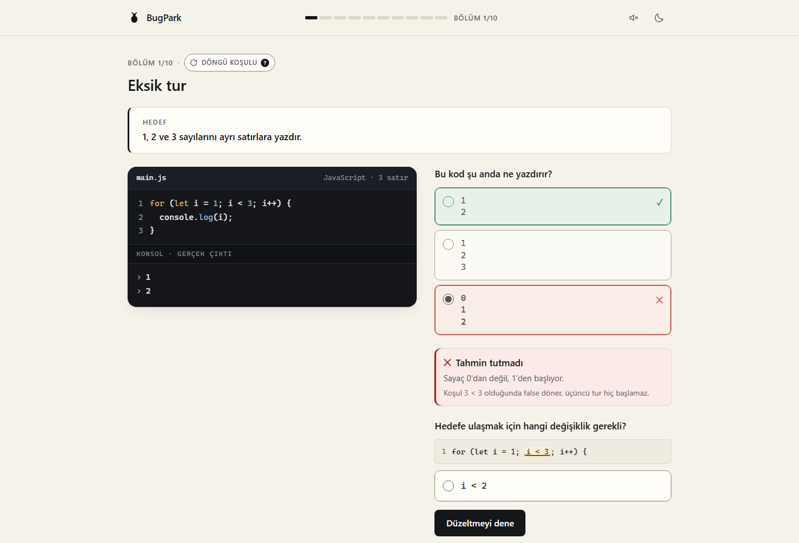
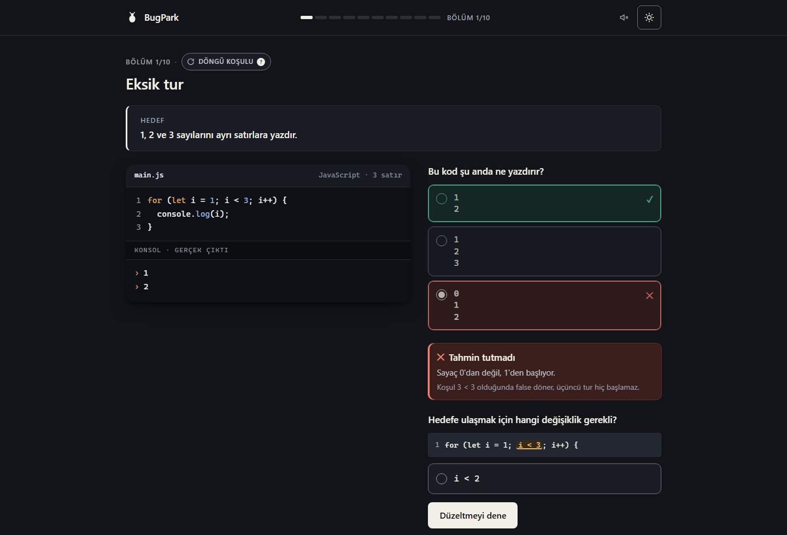
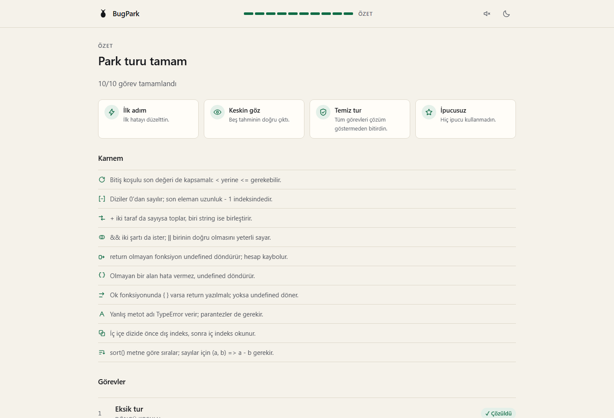
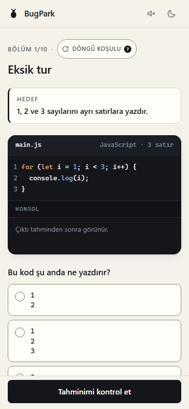

<div align="center">


# BugPark

**Kodu oku, çıktısını tahmin et, hatayı düzelt.**

JavaScript'e yeni başlayanlar için on kısa görevden oluşan, tarayıcıda çalışan bir hata avı oyunu.
Süre yok, puan yok, üyelik yok — sadece kod, çıktı ve neden.

[](tests/)
[](package.json)
[](#erişilebilirlik)
[](LICENSE)

[Canlı demo](https://enes59255X.github.io/bugpark/) · [Özellikler](#özellikler) · [Hızlı başlangıç](#hızlı-başlangıç) · [İçerik ekleme](#yeni-bölüm-ekleme)

</div>


## Ne yapıyor

Her bölümde kasıtlı olarak bozuk bir kod parçası var. Oyuncu önce **bu kodun şu an ne yazdırdığını** tahmin eder,
sonra tek bir değişiklikle hedefe ulaştırır. Tahmin yanlış olsa da akış kilitlenmez: gerçek çıktı, seçilen
seçeneğin neden yanlış olduğu ve hatanın nedeni birlikte gösterilir.

On görev, JavaScript'te en sık yapılan on hatayı hedefler:

| # | Görev | Kavram | Hatalı çıktı → hedef |
| :--: | --- | --- | --- |
| 1 | Eksik tur | Döngü koşulu | `1 2` → `1 2 3` |
| 2 | İlk meyve | Dizi indeksi | `armut` → `elma` |
| 3 | Yan yana sayılar | Tip dönüşümü | `52` → `7` |
| 4 | Kulüp kapısı | Mantık operatörü | `Girebilir` → `Giremez` |
| 5 | Kayıp sonuç | `return` | `undefined` → `6` |
| 6 | Yanlış adres | Nesne alanı | `undefined` → `Ece` |
| 7 | Sessiz hesap | Ok fonksiyonu | `undefined` → `1` |
| 8 | Büyük harf | Metot çağrısı | `TypeError` → `ECE` |
| 9 | İç içe dizi | İç içe indeks | `TypeError` → `3` |
| 10 | Metin gibi sıralama | `sort` karşılaştırıcısı | `10, 100, 9` → `9, 10, 100` |

## Neden böyle

- **Kod çalıştırılmaz.** `eval`, `new Function` veya `innerHTML` yok; örnekler, seçenekler ve çıktılar
  önceden yazılmış metinlerdir. Böylece oyun her yerde aynı davranır ve güvenlik yüzeyi sıfırdır.
- **Renk bilgi taşır, süs değildir.** Arayüz mürekkep ve kâğıt üzerine kuruludur; yeşil/kırmızı/amber
  yalnızca doğru, yanlış ve "çözüm gösterildi" durumlarında görünür — her zaman bir simge ve metinle birlikte.
- **Tek doğru cevap.** Her soruda tam üç seçenek ve tek doğru vardır; yanlış seçenekler pedagojik olarak
  anlamlı yanılgılardır (ör. `metin + Number(sayi)` → `"52"`).

| Tahmin ve gerçek çıktı | Düzeltme ve değişen satır |
| :--: | :--: |
|  |  |

## Hızlı başlangıç

Proje bağımlılık içermez; Node 20+ yalnızca testler için gerekir.

```bash
git clone https://github.com/enes59255X/bugpark.git
cd bugpark
python -m http.server 8000     # ya da: npx serve .
```

Tarayıcıda <http://localhost:8000> adresini aç.

> `index.html` dosyasını çift tıklamak çalışmaz: tarayıcı `file://` üzerinden `data/levels.json` okumayı
> engeller. Oyun bu durumda açıklayıcı bir hata ekranı gösterir.

Testler ve şema doğrulaması:

```bash
npm test                          # 30 birim testi (game.js + tokenize.js)
node tests/validate-levels.mjs    # levels.json şema kontrolü
```

## Özellikler

- **Tahmin → gerçek çıktı → düzeltme** akışı; yanlış cevap akışı kilitlemez.
- **Adım adım ipucu** (isteğe bağlı) ve iki yanlış düzeltmeden sonra **çözümü göster**; çözümle geçilen
  bölüm özette ayrı işaretlenir.
- **Rozetler:** İlk adım, Keskin göz, Temiz tur, İpucusuz — puan değil, davranış rozetleri.
- **Karne:** her bölümün tek cümlelik çıkarımı özet ekranında toplanır.
- **Kavram sözlüğü:** bölüm başlığındaki çipe basınca açılan, klavye ile kullanılabilen diyalog.
- **Kalıcılık:** ilerleme, tema ve ses tercihi `localStorage`'da tutulur; dönüşte "Devam et / Baştan başla".
- **Karanlık tema** ve **isteğe bağlı ses** (WebAudio, varsayılan kapalı).
- **Klavye:** `1`–`3` seç, `Enter` gönder, `N` sonraki bölüm.
- **Sonucu paylaş:** özet ekranı tek tuşla panoya kopyalanabilir bir metin üretir.
- **Sözdizimi renklendirme** `innerHTML` kullanmadan, kendi tokenizer'ı ile yapılır.

| Karanlık tema | Özet ve rozetler |
| :--: | :--: |
|  |  |

<p align="center">
  
  
</p>

## Nasıl çalışır

```text
index.html ──▶ js/app.js ──▶ fetch('./data/levels.json')
                  │              │
                  │              └─ validateLevels()  → bozuksa hata ekranı
                  ├─▶ js/game.js     saf durum makinesi (DOM yok, test edilebilir)
                  ├─▶ js/ui.js       DOM yazımı, odak yönetimi, canlı bölge
                  ├─▶ js/tokenize.js güvenli sözdizimi renklendirme
                  └─▶ js/storage.js  ilerleme ve tercihler (localStorage)
```

Durum makinesi: `intro → predict → fix → solved → summary`. `reduce(state, action)` saf fonksiyondur;
geçersiz eylemde aynı referansı döndürür, bu yüzden çift tıklama veya tekrar gönderim durumu bozamaz.

```js
const next = reduce(state, { type: 'SUBMIT_FIX', choiceId: 'f2' });
// yanlış seçim: faz 'fix' kalır, seçenek kilitlenir, deneme sayısı artar
// doğru seçim: faz 'solved', completed'a { id, outcome: 'solved' } eklenir
```

## Yeni bölüm ekleme

Yalnızca `data/levels.json` düzenlenir; JavaScript'e dokunmak gerekmez. Her bölüm şu alanları taşır:

| Alan | Kural |
| --- | --- |
| `id`, `order` | benzersiz `kebab-case` kimlik; `order` dizideki sırayla aynı |
| `title`, `concept`, `goal` | kısa metinler |
| `code` | gösterilecek kod; satırlar `\n` ile |
| `explain` | hatanın nedeni (tahminden sonra gösterilir) |
| `hint`, `takeaway` | isteğe bağlı ipucu ve tek cümlelik çıkarım |
| `prediction` | `question`, `answerId`, `output` (kodun **şu anki** çıktısı), 3 seçenek |
| `fix` | `question`, `answerId`, `target: { line, snippet }`, `solution`, `output`, 3 seçenek |

`fix.target.line` 1 tabanlıdır ve `snippet` o satırda birebir geçmelidir; düzeltilmiş kod bu alt dizenin
değiştirilmesiyle üretilir. Tüm kurallar `validateLevels()` ile hem açılışta hem testte denetlenir —
tek ihlal oyunu sessizce bozmak yerine açıklayıcı hata ekranına düşürür.

## Testler ve doğrulama

| Kontrol | Sonuç |
| --- | --- |
| Birim testleri (`node --test`) | 30/30 |
| `levels.json` şema doğrulaması | 10 bölüm · 60 seçenek geçerli |
| axe-core 4.10 (WCAG 2.1 A/AA + best-practice) | 7 ekran durumunda 0 ihlal |
| Elle test matrisi | 16 senaryo (klavye, mobil, %200 yakınlaştırma, ağ hatası, çift tıklama) |
| Tarayıcılar | Chrome, Edge, Firefox, Safari son iki sürüm · iOS Safari 16+ |

## Erişilebilirlik

- Her ekranda tek `h1`; ekran değişiminde odak başlığa taşınır, geri bildirimde odak çalınmaz.
- Kısa hükümler tek bir `role="status"` bölgesinde duyurulur; uzun gerekçeler otomatik okunmaz (çift anons yok).
- Odaklı buton asla `disabled` yapılmaz; `aria-disabled` ve işleyici guard'ı kullanılır.
- Durumlar yalnızca renkle anlatılmaz; simge + metin zorunludur. `forced-colors` modunda kenarlıklar korunur.
- `prefers-reduced-motion` açıkken tüm hareket kapanır.
- Ölçülen kontrastlar: gövde 16.19:1, kontrol sınırı 3.50:1, kod tokenları 5.85–10.58:1.

## Bilinen davranışlar

- İlerleme bu tarayıcıya özeldir; hesaplar arasında taşınmaz. "Baştan başla" kaydı siler.
- Tarayıcı geri tuşu oyun içi geri sayılmaz.
- Kod asla çalıştırılmaz; çıktılar önceden yazılmış metinlerdir.
- Mobilde uzun kod satırları alt satıra sarılır; masaüstünde yatay kaydırılır.

## Yol haritası

- [x] Bölüm 6–10 (nesne, ok fonksiyonu, metot, iç içe dizi, `sort`)
- [ ] Bölüm 11–15 (asenkron işlemler, `try/catch`, `map`/`filter`)
- [ ] Serbest mod: rastgele sıra, hatalı çıktıyı kendin yaz
- [ ] Öğretmen görünümü: sınıf için bağlantı ile paylaşılan ilerleme raporu

## Lisans

[MIT](LICENSE) · GençTek başvurusu için geliştirildi.
