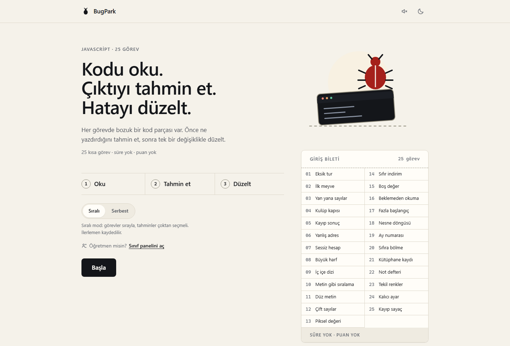
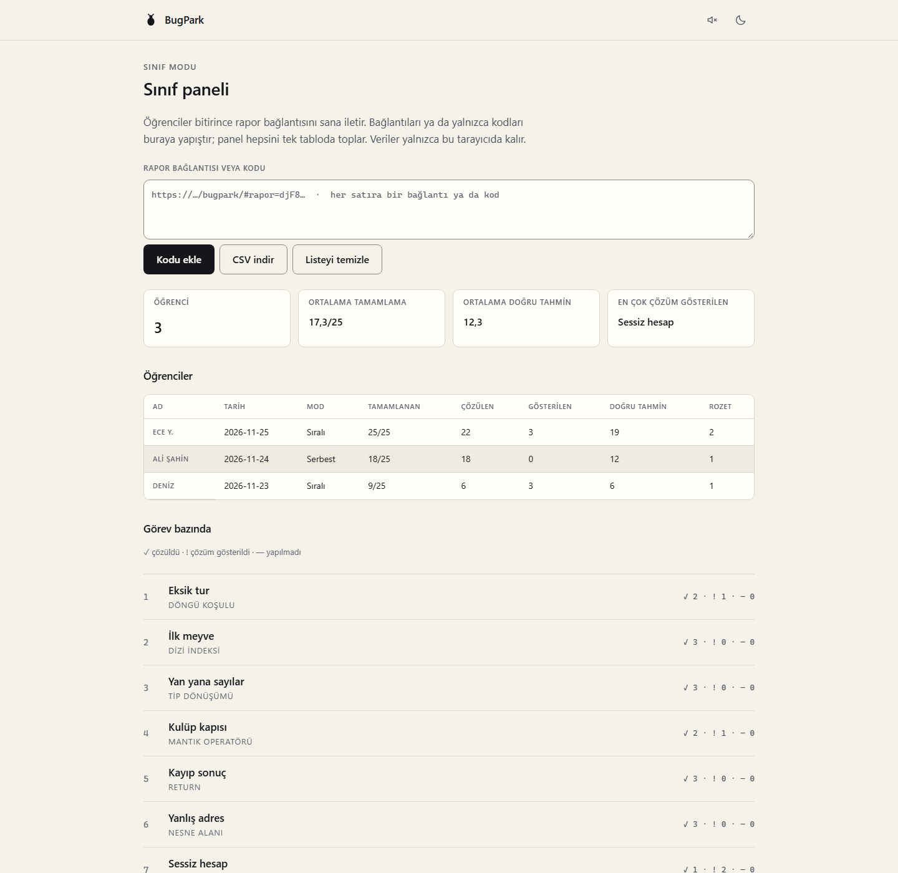
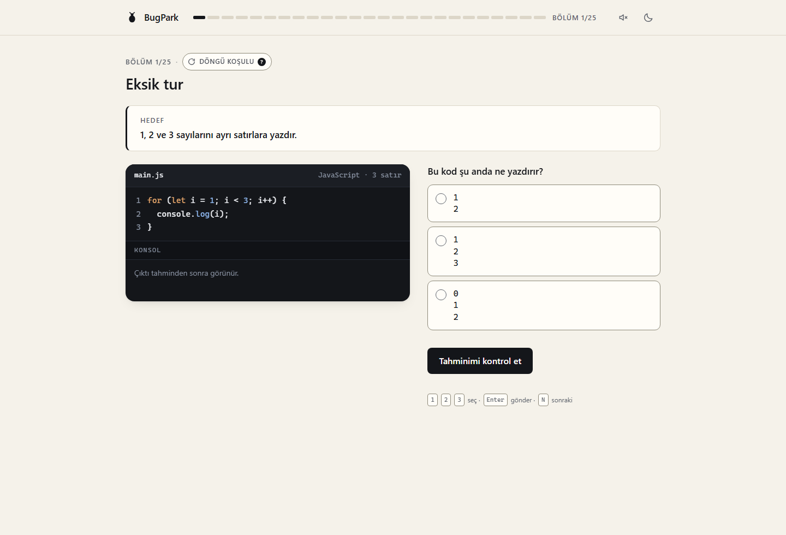
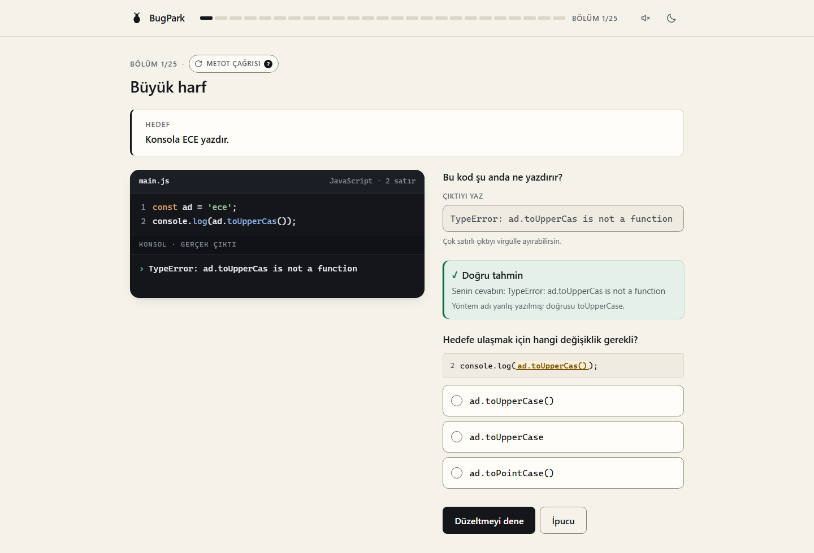
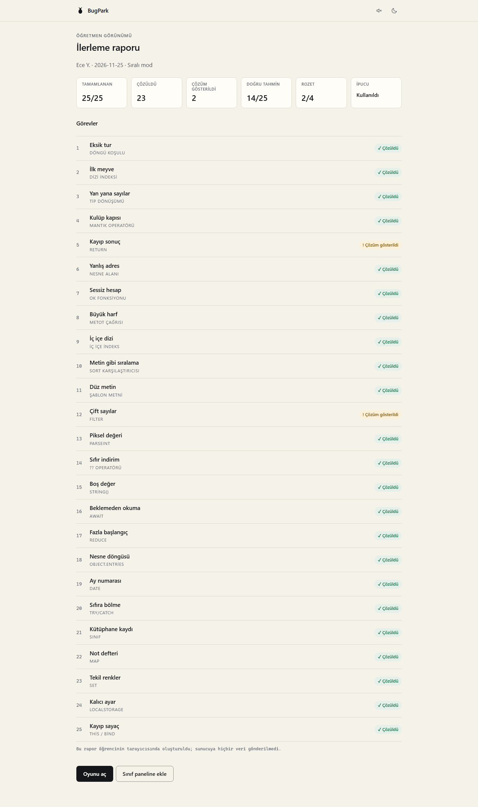
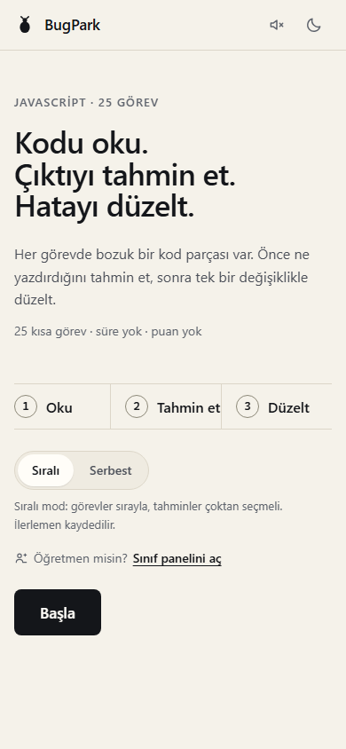

# BugPark

**Kodu oku. Çıktısını tahmin et. Hatayı düzelt.**

Türkçe, tarayıcıda çalışan bir JavaScript hata avı oyunu. 25 kısa görev, süre yok, puan yok, hesap yok.
Kod hiçbir zaman çalıştırılmaz: önce çıktıyı tahmin edersin, sonra tek bir değişiklikle hatayı düzeltir,
nedenini okursun.

<p>
  <a href="https://enes59255x.github.io/bugpark/"></a>
  <a href="https://github.com/enes59255X/bugpark/releases/latest/download/BugPark.html"></a>
</p>

[](tests/)
[](#erişilebilirlik)
[](data/levels.json)
[](LICENSE)



## İndir

| | |
| :-- | :-- |
| **Tek dosya** | [BugPark.html](https://github.com/enes59255X/bugpark/releases/latest/download/BugPark.html) — indir, çift tıkla, oyna. Kurulum, sunucu ve internet gerekmez. |
| **Site** | <https://enes59255x.github.io/bugpark/> — kurulum yok, tarayıcıda açılır. |
| **Kaynak** | [bugpark-kaynak.zip](https://github.com/enes59255X/bugpark/releases/latest/download/bugpark-kaynak.zip) veya `git clone`. |

Tek dosyalık sürüm CSS, JavaScript ve görev verisini tek HTML içine gömer; `file://` üzerinden de çalışır.
(Çift tıklanan sayfalarda bazı tarayıcılar `localStorage`'ı kısıtlar; oyun çalışır, yalnızca ilerleme kaydı tutulmaz.)

## Nasıl oynanır

1. **Oku** — bozuk kod parçasını incele.
2. **Tahmin et** — konsola ne yazacağını seç (ya da serbest modda yaz).
3. **Düzelt** — tek satırlık değişikliklerden doğrusunu seç; gerçek çıktı ve gerekçe hemen görünür.

Yanlış cevap akışı kilitlemez; iki yanlış düzeltmeden sonra çözümü görebilirsin (o görev "çözüldü"
sayılmaz, karneye "çözüm gösterildi" olarak işlenir).

<details>
<summary><strong>25 görevin tamamı</strong> — başlık · kavram · çıktı → hedef</summary>

| # | Başlık | Kavram | Çıktı → Hedef |
| :-- | :-- | :-- | :-- |
| 1 | Eksik tur | Döngü koşulu | `1 2 3` → `1 2 3 4` |
| 2 | İlk meyve | Dizi indeksi | `elma` → `armut` |
| 3 | Yan yana sayılar | Tip dönüşümü | `"3"` → `5` |
| 4 | Kulüp kapısı | Mantık operatörü | `false` → `true` |
| 5 | Kayıp sonuç | `return` | `undefined` → `4` |
| 6 | Yanlış adres | Nesne alanı | `undefined` → `Ece` |
| 7 | Sessiz hesap | Ok fonksiyonu | `undefined` → `1` |
| 8 | Büyük harf | Metot çağrısı | `TypeError` → `MERHABA` |
| 9 | İç içe dizi | İç içe indeks | `a` → `c` |
| 10 | Metin gibi sıralama | `sort` karşılaştırıcısı | `[10, 9, 1]` → `[1, 9, 10]` |
| 11 | Düz metin | Şablon metni | `${ad}` → `Ece` |
| 12 | Çift sayılar | `filter` | `1, 3` → `2, 4` |
| 13 | Piksel değeri | `parseInt` | `12.5` → `12` |
| 14 | Sıfır indirim | `??` | `12` → `0` |
| 15 | Boş değer | `String()` | `TypeError` → `null` |
| 16 | Beklemeden okuma | `await` | `Promise` → `hazır` |
| 17 | Fazla başlangıç | `reduce` | `16` → `6` |
| 18 | Nesne döngüsü | `Object.entries` | `TypeError` → `Ece, 17` |
| 19 | Ay numarası | `Date` | `4` → `5` |
| 20 | Sıfıra bölme | `try/catch` | `Error` → `0` |
| 21 | Kütüphane kaydı | `class` / `new` | `TypeError` → `Kısa Hikâye` |
| 22 | Not defteri | `Map` | `undefined` → `90` |
| 23 | Tekil renkler | `Set` | `TypeError` → `2` |
| 24 | Kalıcı ayar | `localStorage` | `[object Object]` → `{"tema":"koyu"}` |
| 25 | Kayıp sayaç | `this` / `bind` | `TypeError` → `1` |

</details>

## Üç mod

| Mod | Ne yapar |
| :-- | :-- |
| **Sıralı** | 25 görev sırayla; tahmin çoktan seçmeli; ilerleme tarayıcıda saklanır, kaldığın yerden devam edersin. |
| **Serbest** | Görevler karışık sırada; çıktıyı kendin yazarsın (boşluklar ve virgülle ayrılmış satırlar tolere edilir). |
| **Sınıf** | Öğretmen paneli: öğrenci raporlarını toplar, tabloya ve CSV'ye döker. Sunucu gerekmez. |

### Sınıf modu

Öğrenci özet ekranında **Rapor bağlantısı oluştur**'a basar ve bağlantıyı öğretmene iletir. Öğretmen
**Sınıf paneli**'ni açar, bağlantıları (ya da yalnızca kodları) yapıştırır; panel hepsini tek tabloda
toplar:

- öğrenci bazında tamamlanan / çözülen / çözüm gösterilen / doğru tahmin / rozet,
- görev bazında kaç öğrencinin çözdüğü, kaçının çözüm gördüğü,
- ortalama tamamlama, ortalama doğru tahmin ve en çok çözüm gösterilen görev,
- tek tuşla **CSV** (Excel'in Türkçe yerel ayarına uygun, noktalı virgüllü).

Raporlar yalnızca bağlantının içinde taşınır; sınıf listesi öğretmenin tarayıcısında saklanır.
Hesap, sunucu, veri toplama yok.

<p align="center">
  
</p>

## Ekranlar

| Bölüm | Serbest mod: çıktıyı kendin yaz |
| :--: | :--: |
|  |  |

| Öğretmen raporu | Özet ve rozetler |
| :--: | :--: |
|  |  |

<details>
<summary>Daha fazla ekran görüntüsü</summary>

| Karanlık tema | Yanlış tahmin |
| :--: | :--: |
|  |  |

<p align="center">
  
</p>

<p align="center">
  
  
</p>

</details>

## Neden böyle

- **Kod çalıştırılmaz.** `eval`, `new Function` ve `innerHTML` yok. Görevler, seçenekler ve çıktılar
  veriden gelir; sözdizimi renklendirmesi kendi tokenizer'ı ile yapılır ve DOM'a yalnızca
  `createElement` + `textContent` ile yazılır. Oyun, zararlı bir kod parçasını asla yürütmez.
- **Renk bilgi taşır, süs değildir.** Arayüz mürekkep ve kâğıt üzerine kuruludur; yeşil/kırmızı/amber
  yalnızca durum için kullanılır. Her durum ayrıca simge ve metinle anlatılır.
- **Tek doğru cevap.** Her soruda üç seçenek ve tek doğru vardır; yanlış seçenekler pedagojik olarak
  anlamlı hatalardır, rastgele çeldiriciler değil.
- **Bağımlılık yok.** Çerçeve, derleme adımı, web fontu ve ikon kütüphanesi yok; ikonlar satır içi SVG
  sprite, yazı tipi sistem yazı tipi.
- **Çevrimdışı.** Tek dosyalık sürüm internet olmadan, sunucusuz çalışır.

## Erişilebilirlik

| Kontrol | Sonuç |
| :-- | :-- |
| axe-core (WCAG 2.1 A/AA + best-practice) | 9 ekran durumunda 0 ihlal |
| Klavye | Tüm akış klavyeyle tamamlanabilir; `1 2 3` seçer, `N` sonraki görev, `Esc` sözlüğü kapatır |
| Odak | Ekran değişiminde başlığa taşınır; geri bildirim sırasında odak çalınmaz |
| Duyuru | Kısa hükümler tek `role="status"` bölgesinde duyurulur, uzun gerekçeler otomatik okunmaz |
| Renk | Durum asla yalnızca renkle anlatılmaz; kontrastlar ölçüldü (gövde 16.19:1, kontrol sınırı 3.50:1) |
| Hareket | `prefers-reduced-motion` açıkken tüm hareket kapanır; `forced-colors` modunda kenarlıklar korunur |

## Geliştirme

```bash
git clone https://github.com/enes59255X/bugpark.git
cd bugpark
python -m http.server 8000      # ya da npx serve
npm test                        # 56 birim testi (durum makinesi, rapor, sınıf, derleme)
npm run check                   # levels.json şema doğrulaması
npm run build                   # tek dosyalık BugPark.html üretir
```

```text
index.html                 ekranlar + erişilebilirlik iskeleti + SVG sprite
styles.css                 tasarım belirteçleri, bileşenler, karanlık tema
data/levels.json           25 görev (tek doğruluk kaynağı)
js/
  app.js                   JSON yükleme, rotalar, olaylar, tercihler
  game.js                  saf durum makinesi: createGame, reduce, validateLevels, matchesPrediction
  ui.js                    DOM yazımı, odak yönetimi, canlı bölge
  tokenize.js              güvenli sözdizimi renklendirme
  report.js                bireysel rapor kodlama/çözme (base64url)
  classroom.js             sınıf paneli: kod ayıklama, özet, CSV
  storage.js               localStorage sarmalayıcı
tools/build-single.mjs     CSS + JS + veriyi tek HTML'e gömer
tests/                     node --test; veri şeması ayrıca doğrulanır
```

Bir görev eklemek için `data/levels.json`'a kayıt ekle: `id`, `order`, `title`, `concept`, `goal`,
`code`, `explain`, `hint`, `takeaway`, `prediction` ve `fix`. Kural: `fix.target.snippet`, `code`
içindeki `fix.target.line` satırında **birebir** geçmeli; yanlış düzeltmelerin çıktısı hedefle
çakışmamalı. `npm run check` bunu ve sıralamayı doğrular.

## Lisans

[MIT](LICENSE) · Enes
